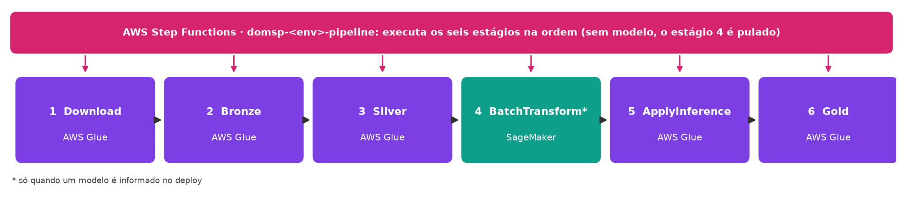
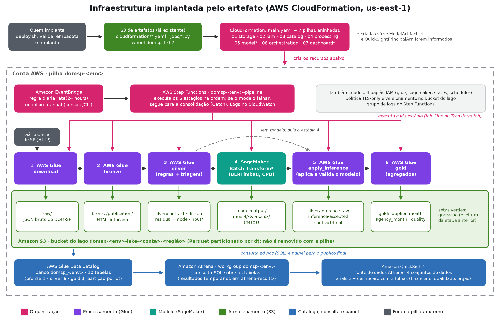
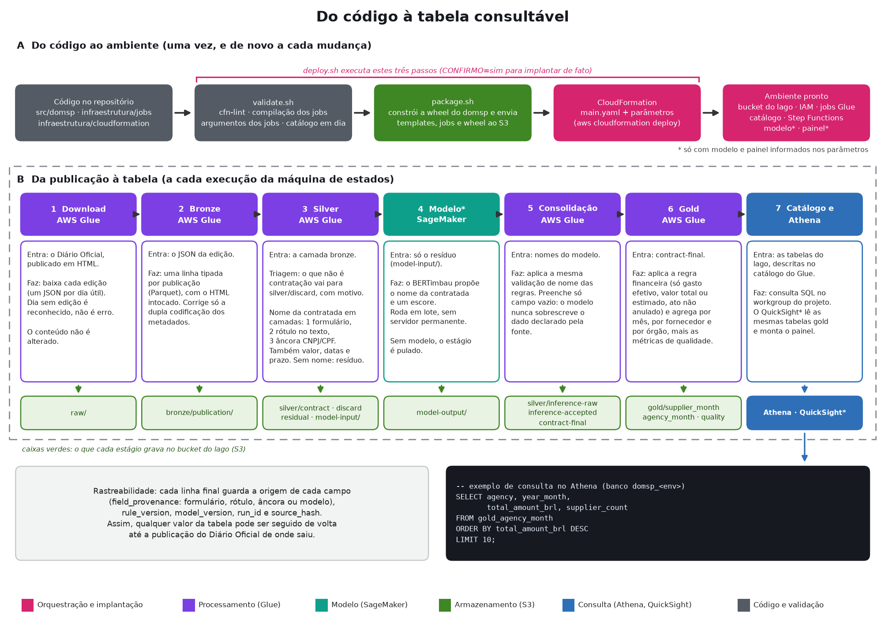

# Extração automatizada de informação de documentos públicos não estruturados: um estudo de caso no Diário Oficial da Cidade de São Paulo

Este repositório contém o código e a infraestrutura de um pipeline ETL que lê os atos de contratação publicados no Diário Oficial da Cidade de São Paulo e os transforma em tabelas estruturadas, consultáveis por SQL. Ele inclui o pacote do modelo treinado (pasta `modelo/`), mas não inclui dados, resultados de experimentos, documentos de texto nem testes (ver [O que não está neste repositório](#o-que-não-está-neste-repositório)).

## O projeto

O Diário Oficial publica contratos, aditamentos e outros atos como texto livre em HTML. Campos como contratada, valor, vigência e número do processo aparecem em formatos variados. O projeto extrai esses campos e grava cada valor com a indicação de como ele foi obtido.

A extração do nome da contratada usa quatro camadas, da mais confiável para a menos:

1. **Formulário**: leitura de blocos estruturados do ato (campos rotulados).
2. **Rótulo na prosa**: expressões como "contratada: ..." no corpo do texto.
3. **Âncora por CNPJ/CPF**: documento fiscal com dígito verificador válido, usado para localizar o nome adjacente.
4. **Modelo**: BERTimbau Large (`neuralmind/bert-large-portuguese-cased`) ajustado para reconhecimento de entidades. Roda apenas sobre o resíduo, isto é, os atos em que as camadas anteriores não encontraram nome.

Regras do projeto:

- O modelo nunca sobrescreve um valor que as camadas determinísticas já preencheram.
- Todo nome, venha de onde vier, passa pela mesma função de validação (`domsp.dominio.parte.porta_de_nome`).
- Cada registro carrega proveniência por campo (`field_provenance`) e as colunas `rule_version`, `model_version`, `run_id` e `source_hash`.
- A regra financeira fica em `src/domsp/contrato/financeiro.py`.
- Há exportação de uma amostra no padrão Open Contracting (OCDS 1.1.5), com validação contra o esquema oficial.
- Um único esquema (`src/domsp/contrato/esquema.py`) gera o catálogo Glue, o DDL e o dicionário de dados.

## Arquitetura

Orquestração na AWS (região us-east-1), por uma máquina de estados do Step Functions chamada `domsp-<env>-pipeline`. São seis estágios: cinco são jobs Glue e um (BatchTransform) é um job do SageMaker.



| Estágio | O que faz |
|---|---|
| Download | Baixa as edições do Diário Oficial para a camada `raw`. |
| Bronze | Lê o JSON bruto de cada edição e grava Parquet tipado, uma linha por publicação, com o HTML do corpo (`body_html`) intocado. A única correção é a da dupla codificação de caracteres, registrada em `encoding_regime`. |
| Silver | Converte o HTML em texto, aplica a triagem e as camadas determinísticas (formulário, rótulo, âncora) e deixa como resíduo o que ficou sem nome. Grava também o resíduo em JSONL (`model-input/`) para o modelo. |
| BatchTransform | Executa o modelo de NER (SageMaker Batch Transform) sobre o resíduo. |
| ApplyInference | Valida as previsões do modelo e as aplica apenas onde o campo está nulo. |
| Gold | Gera os agregados por fornecedor e por órgão (por mês) e a tabela de métricas de qualidade, com regra financeira e proveniência. |

Os jobs Glue em `infraestrutura/jobs/` são cascas finas. A lógica fica no pacote `domsp` (`src/domsp/pipeline`), que é testável localmente.

Serviços usados: S3 (data lake em camadas `raw`, `bronze`, `silver`, `gold`, Parquet particionado por `dt`), Glue (jobs e catálogo), Athena (consulta, workgroup `domsp-<env>`), Step Functions, SageMaker (modelo e Batch Transform), QuickSight (painel, opcional), CloudFormation (toda a infraestrutura).

O bucket do lago é `domsp-<env>-lake-<id-da-conta>-<região>` e tem `DeletionPolicy: Retain`.

Nos nomes dos recursos, `<env>` é o valor do parâmetro `Environment` do CloudFormation (`dev` ou `prod`). Em `infraestrutura/parametros/producao.json` ele é `prod`, então os recursos saem como `domsp-prod-...` e o banco como `domsp_prod`. A variável `ENV` do `deploy.sh` só compõe o nome da pilha (`domsp-$ENV`) e não altera `Environment`.

### Infraestrutura implantada

A figura mostra tudo o que o `deploy.sh` cria na conta AWS e como os recursos se ligam.



Como ler a figura:

- **Faixa superior:** o `deploy.sh` valida e empacota o código, envia templates, jobs e wheel ao bucket de artefatos (que já precisa existir) e chama o CloudFormation. O `main.yaml` cria sete pilhas aninhadas. As pilhas `05 model` e `07 dashboard` só são criadas quando `ModelArtifactUri` e `QuickSightPrincipalArn` são informados.
- **Orquestração:** o EventBridge dispara a máquina de estados do Step Functions uma vez por dia (ou você a inicia à mão). Ela executa os seis estágios na ordem. Se o modelo falhar, ou não existir, o pipeline segue sem ele e publica o que as regras resolveram.
- **Estágios 1 a 6:** cada job Glue lê a camada anterior no S3 e grava a seguinte. O estágio 4 é o único que roda no SageMaker (Batch Transform, em instâncias de CPU).
- **Bucket do lago:** fica no S3 e guarda, em Parquet particionado por data, as camadas `raw`, `bronze`, `silver` e `gold`, mais `model-input/`, `model-output/` e os pesos do modelo. Ele não é removido quando a pilha é apagada.
- **Consumo:** o catálogo do Glue descreve as dez tabelas, o Athena consulta o lago por SQL e o QuickSight (opcional) monta o painel com três folhas.

## Funcionamento do artefato

Do código à tabela consultável:



- **Parte A:** o `deploy.sh` roda a validação (`validate.sh`), empacota o código e envia templates, jobs e wheel ao S3 (`package.sh`) e implanta a pilha no CloudFormation. O resultado é o ambiente pronto, com bucket, papéis, jobs, catálogo, máquina de estados e, se informados, o modelo e o painel.
- **Parte B:** a cada execução da máquina de estados, o Diário Oficial passa pelos estágios download, bronze, silver, modelo (opcional), consolidação e gold. Cada estágio grava seu resultado no bucket do lago, e o catálogo do Glue descreve as tabelas para o Athena e o QuickSight.

Cada registro final guarda de onde veio cada campo (`field_provenance`), a versão da regra (`rule_version`), a do modelo (`model_version`), a execução (`run_id`) e o hash da fonte (`source_hash`).

## Conteúdo das pastas

Cada arquivo em uma linha.

### Raiz

| Arquivo | Função |
|---|---|
| `pyproject.toml` | Metadados do pacote `domsp` e configuração do ruff. |
| `.gitignore` | Exclui caches, builds, notebooks gerados, camadas de dados e pastas de modelos locais do versionamento. |
| `README.md` | Este documento. |
| `modelo/` | Pacote do modelo treinado em 14 partes, com `juntar.sh`, `SHA256SUMS` e `LEIAME.md`. |
| `imagens/infraestrutura.png` | Diagrama da infraestrutura implantada. |
| `imagens/estagios-pipeline.png` | Os seis estágios do pipeline. |
| `imagens/fluxo-codigo-tabela.png` | Diagrama do fluxo do código à tabela consultável. |

### `infraestrutura/cloudformation/`

| Arquivo | Função |
|---|---|
| `main.yaml` | Template raiz: declara os parâmetros e instancia as 7 pilhas aninhadas. |
| `01-storage.yaml` | Bucket S3 do lago (com política) e workgroup do Athena. |
| `02-iam.yaml` | Quatro papéis IAM usados pelos serviços do pipeline. |
| `03-catalog.yaml` | Banco e tabelas Glue (gerado por `gerar_catalogo.py`; não editar à mão). |
| `04-processing.yaml` | Os 5 jobs Glue. |
| `05-model.yaml` | Modelo SageMaker (só existe se `ModelArtifactUri` for informado). |
| `06-orchestration.yaml` | Máquina de estados do Step Functions, log e regra de agendamento diário. |
| `07-dashboard.yaml` | Painel QuickSight (só existe se `QuickSightPrincipalArn` for informado). |

### `infraestrutura/` (demais)

| Arquivo | Função |
|---|---|
| `esquemas/ocds-1.1.5/release-schema.json` | Esquema JSON oficial do OCDS 1.1.5 para validar a exportação. |
| `esquemas/ocds-1.1.5/release-package-schema.json` | Esquema JSON do pacote de releases OCDS. |
| `esquemas/ocds-1.1.5/PROCEDENCIA.txt` | Origem dos esquemas OCDS. |
| `parametros/producao.json` | Valores dos parâmetros da pilha, com placeholders para dados da conta. |
| `jobs/download.py` | Job Glue 1: baixa as edições do Diário Oficial para `raw/`. |
| `jobs/bronze.py` | Job Glue 2: lê o JSON de `raw/` e grava `bronze/publication/` (Parquet tipado, HTML intocado). |
| `jobs/silver.py` | Job Glue 3: gera as saídas da prata (`contract`, `discard`, `residual`) e o JSONL de entrada do modelo (`model-input/`). |
| `jobs/apply_inference.py` | Job Glue 4 (quinto estágio): aplica a saída do modelo e produz `contract-final`. |
| `jobs/gold.py` | Job Glue 5 (sexto estágio): gera os agregados do ouro e as métricas de qualidade. |
| `scripts/deploy.sh` | Valida, empacota e implanta a pilha (só implanta com `CONFIRMO=sim`). |
| `scripts/package.sh` | Constrói a wheel e publica templates, jobs e wheel no bucket de artefatos. |
| `scripts/validate.sh` | Roda cfn-lint, compilação dos jobs, conferência de argumentos e checagem do catálogo (esta etapa regera `03-catalog.yaml` no próprio arquivo e compara com uma cópia anterior). |
| `scripts/conferir_argumentos.py` | Confere se os argumentos que cada job lê batem com os templates. |
| `scripts/gerar_catalogo.py` | Regenera `03-catalog.yaml` a partir do esquema; `--conferir` só compara, sem escrever. |
| `scripts/gerar_dicionario.py` | Gera o dicionário de dados em Markdown (`resultados/dicionario-de-dados.md`) a partir do esquema; `--conferir` só compara. |
| `scripts/exportar_ocds.py` | Lê `dados/silver/contract-final` (requer `pyarrow`), exporta uma amostra OCDS para `resultados/` e a valida. |
| `scripts/lancar_treino.py` | Sobe `dados/gabarito/*.jsonl`, lança o treino no SageMaker e baixa o artefato para `modelos/sagemaker/`. |
| `scripts/empacotar_modelo.py` | Monta o `model.tar.gz` a partir de `modelos/checkpoints/large` e recusa modelo não aprovado. |
| `scripts/consolidar_execucoes.py` | Consolida três execuções de treino (`metricas_modelo.json` de cada uma) e aplica a regra de decisão. |

### `src/`

| Arquivo | Função |
|---|---|
| `requirements.txt` | Dependências do modelo (`transformers`, `tokenizers`). |
| `entrada_treino.py` | Ponto de entrada do job de treino no SageMaker. |
| `domsp/texto/_texto.py` | Converte o HTML publicado em texto Unicode comparável. |
| `domsp/fonte/baixar.py` | Interpreta a resposta do Diário Oficial (edição, sem edição, erro). |
| `domsp/fonte/edicao.py` | Fronteira do bronze: transforma os bytes da fonte em dado. |
| `domsp/dominio/triagem.py` | Decide se a publicação é ato de contratação em escopo. |
| `domsp/dominio/ato.py` | Classifica o tipo do ato e a natureza do dinheiro, e detecta anulação e republicação. |
| `domsp/dominio/dinheiro.py` | Elege o valor do ajuste no texto e classifica sua grandeza. |
| `domsp/dominio/formulario.py` | Camadas 1 a 3: lê o formulário, o rótulo na prosa e a âncora por CNPJ/CPF. |
| `domsp/dominio/parte.py` | Identifica a contratada e o documento fiscal; contém `porta_de_nome`. |
| `domsp/dominio/objeto.py` | Extrai o objeto contratado. |
| `domsp/dominio/tempo.py` | Extrai datas de assinatura, início e fim e o prazo em meses. |
| `domsp/contrato/esquema.py` | Declaração única das colunas; gera catálogo, DDL e dicionário. |
| `domsp/contrato/vocabulario.py` | Conjuntos fechados de valores permitidos. |
| `domsp/contrato/financeiro.py` | Regra que decide quais valores entram em somatórios de gasto. |
| `domsp/contrato/lago.py` | Caminhos de cada camada no S3 e a tabela que a lê. |
| `domsp/contrato/ocds.py` | Exporta a prata no formato OCDS 1.1 e valida o resultado. |
| `domsp/medicao/gabarito.py` | Gabarito automático por redundância dentro do documento. |
| `domsp/medicao/distante.py` | Segundo nível de supervisão distante. |
| `domsp/medicao/incerteza.py` | Intervalo de confiança de cada número publicado. |
| `domsp/modelo/rotulo.py` | Converte o gabarito em rótulos BIO e mede a ida e volta. |
| `domsp/modelo/treinar.py` | Ajuste fino do BERTimbau como classificador de tokens. |
| `domsp/modelo/ajustar.py` | Laço de treino com validação por época, early stopping e checkpoint. |
| `domsp/modelo/servir.py` | Inferência, como entrypoint do Batch Transform e como script local. |
| `domsp/modelo/inferencia_sagemaker.py` | Os quatro ganchos que o contêiner do SageMaker chama. |
| `domsp/modelo/empacotar.py` | Monta o `model.tar.gz` consumido pelo Batch Transform. |
| `domsp/pipeline/bronze.py` | Publicação bruta como linha tipada, sem interpretar. |
| `domsp/pipeline/silver.py` | Triagem e camadas determinísticas, uma linha por ato. |
| `domsp/pipeline/inferir.py` | Fronteira entre pipeline e modelo, nos dois sentidos. |
| `domsp/pipeline/gold.py` | Agregados com significado declarado e métricas do pipeline. |

Os `__init__.py` marcam os pacotes e documentam cada subpacote. `domsp/__init__.py` também define a versão e as constantes `VERSAO_REGRAS` e `MODELO_AUSENTE`.

## Instalação local

Requisitos: Python 3.11 (o `pyproject.toml` exige `>=3.11,<3.12`).

```bash
python3.11 -m venv .venv
source .venv/bin/activate
pip install -e .
pip install pyyaml boto3 jsonschema cfn-lint build
```

Opcionais:

- `pip install -r src/requirements.txt torch` para executar o modelo localmente.
- `pip install pyspark` para executar os jobs com Spark localmente.
- `pip install pyarrow` para usar `exportar_ocds.py`.
- `pip install sagemaker` para usar `lancar_treino.py`.

Validação da infraestrutura (cfn-lint, compilação dos jobs, argumentos dos jobs e catálogo):

```bash
bash infraestrutura/scripts/validate.sh
```

## Implantação na AWS

Pré-requisitos:

- Credenciais AWS configuradas, com permissão para criar as pilhas, papéis IAM, jobs Glue, Step Functions e S3.
- Um bucket S3 já existente para os artefatos (templates, jobs e wheel), informado em `ARTIFACT_BUCKET`.
- `infraestrutura/parametros/producao.json` revisado. Os valores `<BUCKET-DO-LAGO>`, `<ID-DA-CONTA>`, `<PERFIL>` e `<USUARIO>` são placeholders: preencha-os ou deixe o parâmetro vazio.
- `WheelName` igual ao nome do arquivo gerado a partir da versão em `pyproject.toml`.

Parâmetros de `main.yaml`, todos ajustáveis em `parametros/producao.json` (`ArtifactBucket` é preenchido pelo `deploy.sh`):

| Parâmetro | Padrão | Função |
|---|---|---|
| `ArtifactBucket` | (obrigatório) | Bucket S3 existente com templates, jobs e wheel. |
| `Environment` | `dev` | `dev` ou `prod`; sufixo dos nomes dos recursos. |
| `ProjectionStart` | `2024-01-01` | Primeira data de edição coberta pela projeção de partições do Athena (`yyyy-MM-dd`). |
| `WindowFrom` | `tudo` | Início da janela de edições: `yyyy-MM-dd`, `tudo` ou `ultimos:N` (últimos N dias). |
| `WindowTo` | `tudo` | Fim da janela: `yyyy-MM-dd` ou `tudo`. |
| `WheelName` | `domsp-1.0.0-py3-none-any.whl` | Nome da wheel em `s3://<artefatos>/wheel/`; deve casar com a versão do `pyproject.toml`. |
| `ModelArtifactUri` | vazio | URI do `model.tar.gz`. Vazio roda só as camadas determinísticas. |
| `InferenceImageUri` | vazio | Imagem ECR do contêiner de inferência; só é necessária com modelo. |
| `ModelVersion` | `nenhum` | Rótulo gravado em `model_version`. |
| `TransformInstanceType` | `ml.m5.xlarge` | Instância CPU do Batch Transform; mais vCPU encurta a execução. |
| `TransformInstanceCount` | `1` (1 a 16) | Instâncias do Batch Transform; precisa de `FatiasModelo` maior ou igual a esse valor. |
| `FatiasModelo` | `1` (1 a 64) | Em quantos objetos o resíduo é dividido; use cerca de 4 vezes o número de instâncias. |
| `ModelServerWorkers` | `4` | Workers do servidor e transformações concorrentes (os dois devem coincidir). |
| `ThreadsPerWorker` | `2` | Threads do torch por worker; workers vezes threads não deve passar dos vCPU da instância. |
| `QuickSightPrincipalArn` | vazio | ARN do usuário QuickSight. Vazio dispensa o painel (que exige assinatura). |
| `ScheduleState` | `ENABLED` | Estado da regra diária; `DISABLED` impede execuções automáticas. |
| `CreateDataLakeBucket` | `true` | `true` cria o bucket do lago; `false` reutiliza um existente de mesmo nome. |

O `producao.json` já define `WheelName` como `domsp-1.0.2-py3-none-any.whl`, que é a wheel gerada a partir deste repositório.

Para um primeiro deploy sem modelo e sem painel, deixe `ModelArtifactUri`, `InferenceImageUri` e `QuickSightPrincipalArn` vazios. Para implantar com o modelo, siga antes a seção [Modelo](#modelo).

```bash
export ARTIFACT_BUCKET=<seu-bucket-de-artefatos>
export ENV=dev                      # só compõe o nome da pilha (domsp-$ENV); o parâmetro Environment vem de producao.json
bash infraestrutura/scripts/deploy.sh               # apenas valida e mostra o comando
CONFIRMO=sim bash infraestrutura/scripts/deploy.sh # implanta de fato
```

Depois do deploy, inicie a máquina de estados `domsp-<env>-pipeline` pelo console ou pela CLI e consulte os resultados no Athena (banco `domsp_<env>`, workgroup `domsp-<env>`). Aqui `<env>` é o valor de `Environment` (com o `producao.json` fornecido, `prod`), não o de `ENV`.

## Modelo

O modelo treinado está na pasta `modelo/`: o pacote do SageMaker (`model.tar.gz`, 1,2 GB), dividido em 14 partes de 90 MiB porque o GitHub recusa arquivos acima de 100 MB. Ele contém os pesos do BERTimbau Large ajustado, o tokenizador, o código de inferência e a wheel do `domsp` 1.0.0.

Para usar no deploy:

```bash
bash modelo/juntar.sh                  # reconstitui modelo/model.tar.gz e confere o SHA-256
aws s3 cp modelo/model.tar.gz s3://<BUCKET-DO-LAGO>/model/1.0.0/model.tar.gz
```

Depois, em `infraestrutura/parametros/producao.json`, aponte `ModelArtifactUri` para esse caminho e mantenha `ModelVersion` em `1.0.0` e `InferenceImageUri` com a imagem de inferência CPU do Hugging Face já indicada no arquivo. Sem esses três parâmetros, o pipeline roda só as camadas determinísticas.

## Treino

O treino usa `src/entrada_treino.py` no SageMaker, disparado por `infraestrutura/scripts/lancar_treino.py` (`--subir`, `--treinar`, `--baixar NOME_JOB`). Ele exige as variáveis `DOMSP_BUCKET` e `DOMSP_SAGEMAKER_ROLE`, e lê o gabarito em `dados/gabarito`, que não faz parte deste repositório. Para reproduzir o treino é preciso produzir um gabarito próprio. `empacotar_modelo.py` recusa empacotar um modelo não aprovado, a menos que `DOMSP_EM_OBSERVACAO=sim`.

## Pastas locais esperadas pelos scripts

Estas pastas não fazem parte do repositório. Elas são geradas por quem executa o pipeline ou produzidas fora dele, e os scripts as procuram na raiz do projeto.

| Pasta | Quem lê | Quem escreve |
|---|---|---|
| `dados/gabarito/` (`train.jsonl`, `validation.jsonl`, `manifest.json`) | `lancar_treino.py`, `empacotar_modelo.py` | Produzida fora do repositório. |
| `dados/silver/contract-final/` (Parquet) | `exportar_ocds.py` | Cópia local de `silver/contract-final/` do lago. |
| `resultados/` (`metricas_modelo.json`, `manifest_corpus.json`) | `empacotar_modelo.py`, `consolidar_execucoes.py` (via arquivos de execução) | Produzidos fora do repositório. |
| `resultados/` (`dicionario-de-dados.md`, `ocds-amostra.json`, `ocds-validacao.json`, `metricas_modelo_tres_execucoes.json`) | `gerar_dicionario.py --conferir` | `gerar_dicionario.py`, `exportar_ocds.py`, `consolidar_execucoes.py` (este exige que `resultados/` já exista). |
| `modelos/checkpoints/large/` | `empacotar_modelo.py` | Produzida fora do repositório (checkpoint treinado). |
| `modelos/pacote/` | — | `empacotar_modelo.py`. |
| `modelos/sagemaker/` | — | `lancar_treino.py --baixar`. |
| `modelos/historico/` | `consolidar_execucoes.py` (os caminhos são passados em `--execucao`) | Organizada por quem executa o treino. |

## O que não está neste repositório

- Dados do Diário Oficial, gabarito de anotação e resultados de experimentos.
- Documentos de texto, notebooks e checkpoints de treino do modelo (só o pacote final de inferência está em `modelo/`).
- Testes automatizados.
- Identificadores de conta, usuários e perfis da AWS. Os valores correspondentes em `producao.json` são placeholders.

